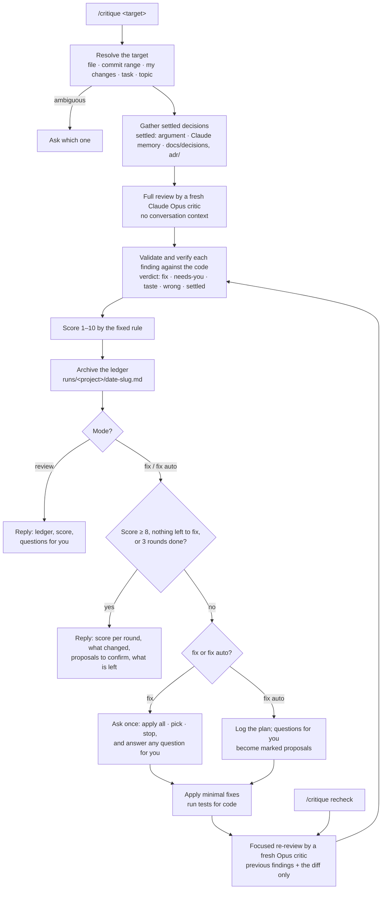

<p align="center">
  <a href="https://github.com/vjfrosty/critique-skill/actions/workflows/ci.yml"></a>
  
  
  
  
</p>

# critique: an independent, scored code and plan review skill for Claude Code

**critique** is a [Claude Code](https://docs.anthropic.com/en/docs/claude-code) skill that gives you a skeptical **second opinion** on a plan, design doc, proposal, diff, commit or work in progress, **scores it 1–10**, and can **fix and re-review it until it scores 8**. A fresh critic with none of your conversation reads the target and the code it touches. The skill then verifies every claim it makes before you see it, and anything only you can decide comes back as a question, not a guess.

| | |
|---|---|
| **Reviews** | plans and design docs, proposals and decisions, commits and commit ranges, uncommitted changes, a task or PR in progress, documentation |
| **Gives you** | a ledger: each finding with an id, a severity, `file:line` evidence and one verdict; a score from 1 to 10; the questions only you can answer |
| **Can also** | fix what it found and re-review, up to three rounds, asking before each round or fully automatic |
| **Works on** | any project and any language; it reads your repository's own rules (`AGENTS.md`, `CLAUDE.md`, `CONTRIBUTING.md`, `README.md`) |
| **Needs** | Claude Code with subagents. Nothing to install besides the skill |
| **Never** | edits in review mode, commits, invents a business fact, or raises a decision you already made |
| **Licence** | MIT |

## Contents

- [Quick start](#quick-start)
- [How it works](#how-it-works)
- [See it working](#see-it-working)
- [What you get](#what-you-get)
- [The score](#the-score)
- [Fix mode](#fix-mode)
- [Why critique](#why-critique)
- [Install](#install)
- [FAQ](#faq)
- [Project layout](#project-layout)
- [Test it](#test-it)
- [Licence](#licence)

## Quick start

```bash
git clone https://github.com/vjfrosty/critique-skill ~/.claude/skills/critique
```

Then, in Claude Code, in any project:

```
/critique docs/plans/migration.md          review and score a plan
/critique my changes                       review your uncommitted work
/critique HEAD~3..HEAD                     review the last three commits
/critique fix docs/plans/migration.md      fix and re-review, asking before each round
/critique fix auto docs/plans/migration.md fix and re-review without asking
/critique recheck                          one re-check of the last ledger after you acted on it
```

Options go anywhere in the arguments: `focus: <what to weigh first>`, `settled: <decisions the critic must not raise>`.

## How it works



Review mode never edits. Fix mode never commits. The first review reads the whole target; every later one reads only the previous findings and the lines that changed, so fixes are not re-judged as a new document and each round is faster than the first.

## See it working

`/critique fix auto deploy-plan.md` on a 30-line plan to move an API to a new server. The plan, as written, committed the production `.env` to git, opened Postgres to the internet, promised zero downtime while stopping the API for a 60 GB restore, and deleted the old server the same evening:

```
Score per round: 2 → 6 → 8. Target 8 reached after two fix rounds, in 5 minutes.
The 8 assumes you accept the proposals below.

Round 0 — 2/10 (5 important, 3 advice; all verified, none dropped)
| id | severity  | verdict | finding                                                        | evidence |
|----|-----------|---------|----------------------------------------------------------------|----------|
| c1 | important | fix     | Port 5432 open to the world; the data moves as a dump anyway   | step 1   |
| c2 | important | fix     | Production .env committed to the repo as deploy/prod.env       | step 2   |
| c3 | important | fix     | "Zero downtime" while step 4 stops the API for a 60 GB restore | goal, 4  |
| c4 | important | fix     | No way back: old server deleted the same evening, no backups   | 7, Rollback |
...

Proposals to confirm (each marked "proposed — confirm" in the plan):
1. A maintenance window of at most 2 hours, announced to customers.
2. Keep Friday evening, or move to a weekday morning?
3. Keep the stopped server for 14 days before deleting it.
4. Restart the old API if the new one has not passed its checks 90 minutes in.

Needs you:
1. Which off-box backup target, are the dumps encrypted, and how long are they kept?
```

Each fix is the smallest edit that makes its finding false, so the plan stays readable. Here it stayed at 30 lines.

## What you get

A **ledger**, saved under `~/.claude/skills/critique/runs/<project>/<date>-<target>.md` (a second run the same day gets `-2`, never overwriting the first) and never in your repository. Every finding has:

- an **id** (`c1`, `c2`, …), so fixes and re-checks can refer to it;
- a **severity**: `important` (breaks production, loses data, breaks a contract or a security boundary, or the plan cannot work as written), `advice` (a clear improvement) or `info`;
- **evidence**: a `file:line`, a section or a commit, and the mechanism by which it breaks. A finding without both is dropped, and the drop is counted;
- one **verdict**, given after the claim was checked against the code:

| Verdict | Meaning |
|---|---|
| `fix` | Real, verified, concrete benefit |
| `needs-you` | Only you can decide: a fact, a cost, a product or contract choice, a trade-off you own |
| `taste` | Could go either way; the trade-off in one line |
| `wrong` | The critic was mistaken, with how it was checked |
| `settled` | Re-opens a decision you already made |

An `important` finding always ends as `fix`, `needs-you`, `wrong` or `settled`, never `taste` and never open.

## The score

The score comes from the verified findings, by a fixed rule, so two runs on the same target give comparable numbers:

| Findings left open | Score |
|---|---|
| no `important` | 10 minus the number of `advice` findings, lowest 5 |
| one or more `important` | 6 minus (number of `important` − 1), lowest 1 |

**8 means nothing important and at most two advice-level findings.** `info`, `wrong` and `settled` findings, and findings answered by a proposal you have yet to confirm, do not count. The critic gives its own score too; when the two differ by 2 or more, the reply says why.

## Fix mode

`/critique fix` reviews, then repeats up to **three rounds**:

1. It plans the round: one line per fix, plus every question only you can answer.
2. `fix` asks you once: apply all, pick some, or stop, and answer the questions there. `fix auto` never asks: it logs the plan and turns each question into a marked proposal, taking the smaller, reversible option (`14 days (proposed — confirm)`).
3. It applies each fix as the smallest edit that makes the finding false, and runs your tests for code.
4. A fresh critic does a **focused re-review**: it checks each previous finding and looks for new problems only in the lines that changed.

It stops at a score of 8 or more, when nothing left is its to fix, or after the third round. A finding answered by a proposal leaves the score, and the reply lists the proposals so you can confirm or change them. It never commits; you do.

**It does not always reach 8 in three rounds.** A plan with many decisions only you can make, or fixes that open new questions, can end at 6 or 7. When that happens the reply says so and lists exactly what still stands.

`/critique recheck` runs the same focused re-review once, after you have acted on a ledger yourself.

## Why critique

- **Independent.** The critic is a new Claude Opus subagent that has not seen your conversation, so it is not anchored on the reasoning that produced the plan.
- **Verified.** The critic's claims are checked against the code before you see them. A mistaken claim is shown as `wrong`, with how it was checked, instead of being passed on.
- **No invented facts.** When the right answer depends on something only you know, the finding becomes a question.
- **Remembers your decisions.** It collects what you have already settled from your `settled:` argument, the project's Claude memory and any `docs/decisions` or `adr/` folder, and the critic may not raise those again.
- **Bounded.** At most three fix rounds; the ledger records every round.

In a side-by-side test on three targets (a commit in a web application, a project handover document, and the deploy plan in `evals/`), runs with the skill passed 93% of the checks and runs without it 33%. Without the skill, Claude ran a fourth fix round on a scale it made up and wrote a cutover time, a retention period and a DNS TTL into the plan as if they had been decided. With the focused re-review, two runs of the fix loop on the same plan both reached 8, in two and three rounds, taking 5 and 7 minutes.

On obvious bugs the skill adds less: on the small module in `evals/`, Claude without the skill found the same four planted bugs. The skill added a score by the fixed rule and one question only the owner could answer.

## Install

```bash
git clone https://github.com/vjfrosty/critique-skill ~/.claude/skills/critique
```

On Windows, `~` is `%USERPROFILE%`. Claude Code picks the skill up in every project. To update: `git -C ~/.claude/skills/critique pull`.

## FAQ

**Does it change my files?**
Not in review mode. In `fix` mode it edits the target and runs your tests, but never commits.

**Which model does it use?**
The critic is always Claude Opus, whatever model your session uses. The verification and the fixes run on your session's model.

**Can I review something that is not finished?**
Yes. Pass `my changes`, a task or PR id, or the plan. The critic is told what is done and what is still planned, so a planned step is not reported as missing. A planned step that cannot work as planned is still reported.

**How do I stop it raising something I already decided?**
Pass `settled: we keep the monolith`, or record the decision in `docs/decisions/` or `adr/`. Findings that re-open it are marked `settled` and do not count.

**Why did it stop below 8?**
Either three rounds have run, or everything left needs your answer (in `fix` mode) or is a judgement call. The reply lists what is still open.

**How long does it take?**
A review takes a few minutes. Each fix round adds a focused re-review, which is shorter than the first review because it reads only the previous findings and the changed lines.

## Project layout

```
SKILL.md          the orchestration: resolve the target, gather settled decisions, spawn the critic,
                  verify, score, archive, fix loop
critic_prompt.md  the reviewer's instructions and output format; edit this to change what counts as
                  important or which kinds of finding exist
evals/            test cases in the claude plugin eval layout: a fix loop on a flawed deploy plan,
                  and a review of a small module with planted bugs
llms.txt          a short description for language models
CHANGELOG.md      what changed, by version
```

## Test it

The `evals/` folder holds test cases in the layout `claude plugin eval` reads:

```bash
cd ~/.claude/skills/critique
claude plugin eval . --allow-tools Write,Edit,Bash --scaffold
```

These are real, billed model runs, with and without the skill. CI checks only the skill's structure: front matter, links between files and test case layout.

## Licence

MIT, © 2026 Yasen Ivanov (`LICENSE`).
