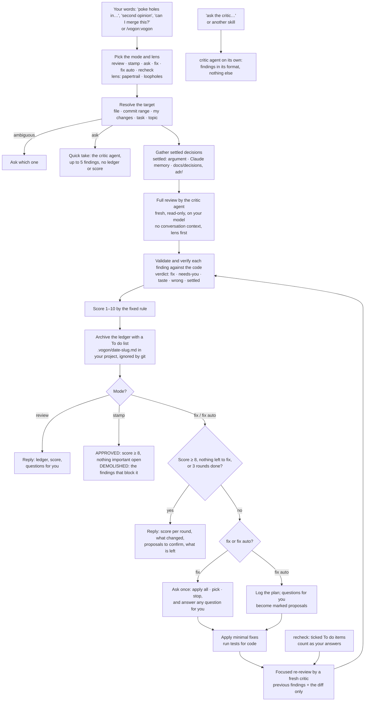

<p align="center">
  
  &nbsp;&nbsp;&nbsp;
  
</p>

<p align="center">
  <a href="https://github.com/vjfrosty/vogon/actions/workflows/ci.yml"></a>
  
  
  
  
  
</p>

# vogon: an independent, scored code and plan review plugin for Claude Code

**vogon** is a [Claude Code](https://docs.anthropic.com/en/docs/claude-code) plugin that gives you a skeptical **second opinion** on a plan, design doc, proposal, diff, commit or work in progress, **scores it 1–10**, and can **fix and re-review it until it scores 8**. A fresh critic with none of your conversation reads the target and the code it touches. The skill then verifies every claim before you see it, and anything only you can decide comes back as a question, not a guess.

It ships two parts:

- the **`vogon` skill**: the full review, with a ledger, a score and an optional fix loop;
- the **`critic` agent**: the read-only reviewer the skill uses, which you and other skills can also call on its own.

| | |
|---|---|
| **Reviews** | plans and design docs, proposals and decisions, commits and commit ranges, uncommitted changes, a task or PR in progress, documentation |
| **Gives you** | a ledger: each finding with an id, a severity, `file:line` evidence and one verdict; a score from 1 to 10; the questions only you can answer |
| **Can also** | fix what it found and re-review, up to three rounds, asking before each round or fully automatic; give a merge verdict (`APPROVED` / `DEMOLISHED`); look first at docs vs. code (`papertrail`) or at error handling and edge cases (`loopholes`) |
| **Model** | yours: the critic runs on the model your session uses, unless you name another |
| **Works on** | any project and any language; it reads your repository's own rules (`AGENTS.md`, `CLAUDE.md`, `CONTRIBUTING.md`, `README.md`) |
| **Never** | edits in review mode, commits, invents a business fact, or raises a decision you already made. The critic agent cannot edit at all |
| **Licence** | MIT |

## Status

**Version 0.0.1, first public release, still being tuned.** What is tested, as of 2026-11-13:

| Area | Result |
|---|---|
| Review, stamp and lenses | 4 test cases (planted bugs, a data-loss bug under `stamp`, stale docs, swallowed errors): all 17 checks passed, 2½–3½ minutes each |
| Starting from plain words | 22 requests run at least twice: never started on the 11 that were not review requests; "what edge cases did I miss" is the weakest trigger |
| Asking before it starts | Started from your own words, it asks once before any critic runs; naming vogon or typing the command skips the question |
| Fix loop | On the deploy-plan test it reached 8 in 2 of 7 runs and otherwise stopped at 6–7, in 11–15 minutes for about $3. Each round fixes nearly every open finding, but each re-review finds about one new important and three new advice findings in the text just written, so the score stalls; a re-review that reports only new important problems is being tested. When it stops below 8, it names the decision that blocks it |
| Ledger hook | 13 tests pass on Linux, Windows and macOS in CI |
| Cost | About 350 tokens always loaded; about 3.7k for the skill and 2.6k for each critic when it runs (`claude plugin details vogon@vogon`) |

## Contents

- [Status](#status)
- [Install](#install)
- [Use it](#use-it)
- [How it works](#how-it-works)
- [See it working](#see-it-working)
- [What you get](#what-you-get)
- [The score](#the-score)
- [Fix mode](#fix-mode)
- [Stamp and lenses](#stamp-and-lenses)
- [The critic agent](#the-critic-agent)
- [Why vogon](#why-vogon)
- [FAQ](#faq)
- [Project layout](#project-layout)
- [Test it](#test-it)
- [Licence](#licence)

## Install

In Claude Code:

```
/plugin marketplace add vjfrosty/vogon
/plugin install vogon@vogon
```

Start a new session afterwards. To update later: `/plugin marketplace update vogon`.

<details>
<summary>Without the plugin system</summary>

Copy the two parts into your personal Claude folders. On macOS and Linux:

```bash
git clone https://github.com/vjfrosty/vogon /tmp/vogon
cp -r /tmp/vogon/skills/vogon "$HOME/.claude/skills/vogon"
cp /tmp/vogon/agents/critic.md "$HOME/.claude/agents/critic.md"
```

On Windows, Claude Code reads `%USERPROFILE%\.claude`. In Git Bash, `~` and `$HOME` can point to a network home drive instead, so use `$USERPROFILE` in place of `$HOME`. The skill then runs as `/vogon`, and finds the agent as `critic`.

</details>

## Use it

Just ask, in any project. No slash needed:

```
> poke holes in docs/plans/migration.md
> give me a second opinion on my uncommitted changes
> is my branch ready for a PR?
> rate this design doc 1 to 10
> quick take: what would a critic say about the retry logic?
> critique my changes and fix them until they pass, don't ask me
> ask the critic whether this caching approach holds up
> vogon, can I merge this?
> are the docs still right for the client module?
> what edge cases did I miss in sync.py?
```

Claude picks the mode from your words and **asks once before it starts** (run it, a quick take instead, or answer normally), so a review never runs unless you want one. Naming vogon ("vogon, can I merge this?") or typing the command skips that question. Typing `/vogon:vogon` shows the options:

```
/vogon:vogon docs/plans/migration.md          review and score a plan
/vogon:vogon my changes                       review your uncommitted work
/vogon:vogon HEAD~3..HEAD                     review the last three commits
/vogon:vogon stamp my changes                 review + APPROVED or DEMOLISHED, before you merge
/vogon:vogon papertrail README.md             review that checks the docs against the code first
/vogon:vogon loopholes src/sync.py            review that checks error handling and edge cases first
/vogon:vogon ask src/retry.ts                 quick take: findings only, no ledger or score
/vogon:vogon fix docs/plans/migration.md      fix and re-review, asking before each round
/vogon:vogon fix auto docs/plans/migration.md fix and re-review without asking
/vogon:vogon recheck                          one re-check of the last ledger after you acted on it
```

A lens (`papertrail`, `loopholes`) combines with any mode: `/vogon:vogon fix loopholes src/`. Each word also has shorter alternatives:

| Word | Also accepted |
|---|---|
| `stamp` | `gate`, `verdict`, `inspect`, `audit` |
| `papertrail` | `docs`, `comments` |
| `loopholes` | `edges`, `errors`, `holes` |
| `ask` | `quick` |
| `recheck` | `again` |

Options go anywhere in the arguments: `focus: <what to weigh first>`, `settled: <decisions the critic must not raise>`, `model: <opus | sonnet | haiku | fable>` (the critic's model; by default it is yours).

## How it works



Review mode never edits. Fix mode never commits. The first review reads the whole target; every later one reads only the previous findings and the lines that changed, so fixes are not re-judged as a new document and each round is faster than the first.

## See it working

A fix loop in auto mode on a 30-line plan to move an API to a new server. The plan, as written, committed the production `.env` to git, opened Postgres to the internet, promised zero downtime while stopping the API for a 60 GB restore, and deleted the old server the same evening:

```
Score per round: 2 → 6 → 8. Target 8 reached after two fix rounds, in 5 minutes.
The 8 assumes you accept the proposals below.

Round 0 — 2/10 (5 important, 3 advice; all verified, none dropped)
| id | severity  | verdict | finding                                                        | evidence |
|----|-----------|---------|----------------------------------------------------------------|----------|
| c1 | important | fix     | Port 5432 open to the world; the data moves as a dump anyway   | step 1   |
| c2 | important | fix     | Production .env committed to the repo as deploy/prod.env       | step 2   |
| c3 | important | fix     | "Zero downtime" while step 4 stops the API for a 60 GB restore | goal, 4  |
| c4 | important | fix     | No way back: old server deleted the same evening, no backups   | 7, Rollback |
...

Proposals to confirm (each marked "proposed — confirm" in the plan):
1. A maintenance window of at most 2 hours, announced to customers.
2. Keep Friday evening, or move to a weekday morning?
3. Keep the stopped server for 14 days before deleting it.
4. Restart the old API if the new one has not passed its checks 90 minutes in.

Needs you:
1. Which off-box backup target, are the dumps encrypted, and how long are they kept?
```

Each fix is the smallest edit that makes its finding false, so the plan stays readable. Here it stayed at 30 lines.

## What you get

A **ledger**, saved in your project as `.vogon/<date>-<target>.md`. The folder carries its own `.gitignore` (`*`), so git ignores it and nothing reaches your commits; the plugin never edits your `.gitignore` or anything in `.git/`. A small hook lets the skill save there **without a permission prompt**, and only there: every other write keeps your normal permissions. A second run the same day gets `-2`; the hook refuses to overwrite an existing ledger, and later rounds are appended to it. The ledger ends with a **To do** list: one checkbox per question only you can answer and per proposal to confirm. Tick them, write your answer after the item, and run `recheck`: ticked items count as your answers. Every finding has:

- an **id** (`c1`, `c2`, …), so fixes and re-checks can refer to it;
- a **severity**: `important` (breaks production, loses data, breaks a contract or a security boundary, or the plan cannot work as written), `advice` (a clear improvement) or `info`;
- **evidence**: a `file:line`, a section or a commit, and the mechanism by which it breaks. A finding without both is dropped, and the drop is counted;
- one **verdict**, given after the claim was checked against the code:

| Verdict | Meaning |
|---|---|
| `fix` | Real, verified, concrete benefit |
| `needs-you` | Only you can decide: a fact, a cost, a product or contract choice, a trade-off you own |
| `taste` | Could go either way; the trade-off in one line |
| `wrong` | The critic was mistaken, with how it was checked |
| `settled` | Re-opens a decision you already made |

An `important` finding always ends as `fix`, `needs-you`, `wrong` or `settled`, never `taste` and never open.

## The score

The score comes from the verified findings, by a fixed rule, so two runs on the same target give comparable numbers:

| Findings left open | Score |
|---|---|
| no `important` | 10 minus the number of `advice` findings, lowest 5 |
| one or more `important` | 6 minus (number of `important` − 1), lowest 1 |

**8 means nothing important and at most two advice-level findings.** `info`, `wrong` and `settled` findings, and findings answered by a proposal you have yet to confirm, do not count. The critic gives its own score too; when the two differ by 2 or more, the reply says why.

## Fix mode

`fix` reviews, then repeats up to **three rounds**:

1. It plans the round: one line per fix, plus every question only you can answer.
2. `fix` asks you once: apply all, pick some, or stop, and answer the questions there. `fix auto` never asks: it logs the plan and turns each question into a marked proposal, taking the smaller, reversible option (`14 days (proposed — confirm)`).
3. It applies each fix as the smallest edit that makes the finding false, and runs your tests for code. It prefers rewording or removing to adding, logs the target's net growth since the start after each round, and stops once it has grown by more than about a fifth.
4. A fresh critic does a **focused re-review**: it checks each previous finding and looks for new problems only in the lines that changed.

It stops at a score of 8 or more, when nothing left is its to fix, or after the third round. A finding answered by a proposal leaves the score, and the reply lists the proposals so you can confirm or change them. It never commits; you do.

**It does not always reach 8 in three rounds.** A plan with many decisions only you can make, or fixes that open new questions, can end at 6 or 7. When that happens the reply says so and lists exactly what still stands.

`recheck` runs the same focused re-review once, after you have acted on a ledger yourself.

## Stamp and lenses


**`stamp`** is a full review with one more line first: `APPROVED — 9/10` when the score is 8 or more and nothing important is open, otherwise `DEMOLISHED — 4/10, blocked by c1, c4`. It never fixes; a DEMOLISHED reply points to `fix`.

A **lens** tells the critic where to look first and deepest. It still reports anything important it finds elsewhere.

- **`papertrail`**: the README, docstrings, comments, examples, changelog and rules files against what the code does: wrong defaults, renamed or removed options still documented, examples that would not run.
- **`loopholes`**: what happens when things go wrong: swallowed or too-broad exceptions, fallbacks that hide failures, empty, null and over-limit input, retries without a bound, missing timeouts, partial writes.

The lenses follow the pattern of Anthropic's own review plugin (`pr-review-toolkit`), whose focused reviewers check comments against code and hunt silent failures.

## The critic agent

`vogon:critic` is the reviewer on its own: the same instructions the skill uses, with nothing around them.

- **Read-only by construction.** It has Read, Grep, Glob and Bash, and no Edit or Write tools. Asked to fix something, it reports findings and leaves the fix to the caller.
- **Your model.** It inherits the model of whoever calls it.
- **Starts only when named.** Claude delegates to it when you name it or another skill calls it, never by itself.
- **Call it directly** ("ask the critic about the caching approach", or `@agent-vogon:critic`) for findings in its usual format, without verification, a ledger or a score. For those, use the skill.
- **Use it from your own skills and workflows** with `subagent_type: "vogon:critic"`. Start the prompt with `Review target: <what to review>`, and optionally `Focus:` and `Settled:` lines.

## Why vogon

- **Independent.** The critic is a fresh subagent that has not seen your conversation, so it is not anchored on the reasoning that produced the plan.
- **Verified.** The critic's claims are checked against the code before you see them. A mistaken claim is shown as `wrong`, with how it was checked, instead of being passed on.
- **No invented facts.** When the right answer depends on something only you know, the finding becomes a question.
- **Remembers your decisions.** It collects what you have already settled from your `settled:` argument, the project's Claude memory and any `docs/decisions` or `adr/` folder, and the critic may not raise those again.
- **Bounded.** At most three fix rounds; the ledger records every round.

In a side-by-side test on three targets (a commit in a web application, a project handover document, and the deploy plan in `evals/`), runs with the skill passed 93% of the checks and runs without it 33%. Without the skill, Claude ran a fourth fix round on a scale it made up and wrote a cutover time, a retention period and a DNS TTL into the plan as if they had been decided. With the focused re-review, two runs of the fix loop on the same plan both reached 8, in two and three rounds, taking 5 and 7 minutes. These tests ran with the critic on Claude Opus.

On obvious bugs the skill adds less: on the small module in `evals/`, Claude without the skill found the same four planted bugs. The skill added a score by the fixed rule and one question only the owner could answer.

## FAQ

**Does it change my files?**
Not in review mode, and the critic agent cannot edit at all. In `fix` mode the skill edits the target and runs your tests, but never commits.

**Do I have to type a command?**
No. Ask in your own words ("poke holes in…", "second opinion on…", "is this ready for a PR?", "rate this 1 to 10") and Claude offers the skill, picks the mode and asks once before running it. In a test of 22 requests, run at least twice each, it picked the skill for the critique requests and never for the 11 that were not (renames, explanations, tests, build errors, typo fixes, README updates, merges). "What edge cases did I miss" is the weakest phrase: for a small file Claude sometimes reviews it directly instead.

**Why `/vogon:vogon stamp` and not `/vogon:stamp`?**
Claude Code has no alias feature for plugin commands, and every extra command adds its description to the context of every conversation. One command with words after it costs less, and the `/` menu shows the words as you type. Plain sentences ("vogon, can I merge this?") work either way.

**Can `stamp` block a push?**
Not yet: it gives a verdict, and you decide. A hook that refuses `git push` without a fresh APPROVED is possible later.

**Which model does it use?**
Yours: the critic runs on the model your session uses. `model: session` is the default. Add `model: opus` (or say "use Opus") to run it on a stronger one for an important review; `sonnet`, `haiku` and `fable` work too. A stronger critic finds more real problems, and the fix loop depends on what it finds.

**What is the difference between `ask`, the agent and a review?**
`ask` and the agent give the critic's top findings as they are, in about a minute. A review also checks every finding against the code, scores the target and saves a ledger.

**Can I review something that is not finished?**
Yes. Pass `my changes`, a task or PR id, or the plan. The critic is told what is done and what is still planned, so a planned step is not reported as missing. A planned step that cannot work as planned is still reported.

**How do I stop it raising something I already decided?**
Pass `settled: we keep the monolith`, or record the decision in `docs/decisions/` or `adr/`. Findings that re-open it are marked `settled` and do not count.

**Why did it stop below 8?**
Either three rounds have run, or everything left needs your answer (in `fix` mode) or is a judgement call. The reply lists what is still open.

**Will it ask permission to save the ledger?**
No. The plugin's hook (`hooks/allow-ledger.mjs`) answers "allow" for writes inside the current project's `.vogon/` folder, "deny" for a write over an existing ledger, and stays silent for everything else, so your normal rules apply to all other files. The hook runs with Node.js; without Node, it does nothing and you see the usual permission prompt once.

**How long does it take?**
A review takes a few minutes. Each fix round adds a focused re-review, which is shorter than the first review because it reads only the previous findings and the changed lines.

## Project layout

```
.claude-plugin/plugin.json       the plugin: name, version, description
.claude-plugin/marketplace.json  lets the repo be added with /plugin marketplace add
skills/vogon/SKILL.md            the skill: modes and words, resolve the target, gather settled decisions,
                                 call the critic, verify, score, archive, stamp
skills/vogon/references/fix-loop.md  the fix loop, read only in fix mode: minimal fixes, no
                                 over-extension, at most three rounds
agents/critic.md                 the critic agent: read-only tools, your model, the lenses, and the
                                 reviewer's instructions and output format (edit this to change what
                                 counts as important or which kinds of finding exist)
hooks/hooks.json                 a PreToolUse hook for Write and Edit
hooks/allow-ledger.mjs           allows writes inside <project>/.vogon/ only, without a prompt, and
                                 refuses to overwrite an existing ledger
tests/allow-ledger.test.cjs      tests for the hook
assets/                          the logo (logo.svg), the plugin icon (icon.png) and the mascot
evals/                           test cases in the claude plugin eval layout: a fix loop on a flawed
                                 deploy plan, planted bugs, a stamp on a data-loss bug, stale docs,
                                 swallowed errors, a quick take, and a recheck with ticked answers
llms.txt                         a short description for language models
CHANGELOG.md                     what changed, by version
```

## Test it

```bash
git clone https://github.com/vjfrosty/vogon vogon && cd vogon
claude plugin validate .
claude plugin eval . --allow-tools Write,Edit,Bash --scaffold
```

The evals are real, billed model runs, with and without the plugin. CI checks the structure (the plugin and marketplace files, the skill and agent front matter, the command words and lenses, and the test case layout) and runs the hook's tests on Linux, Windows and macOS.

## Licence

MIT, © 2026 Yasen Ivanov (`LICENSE`).
